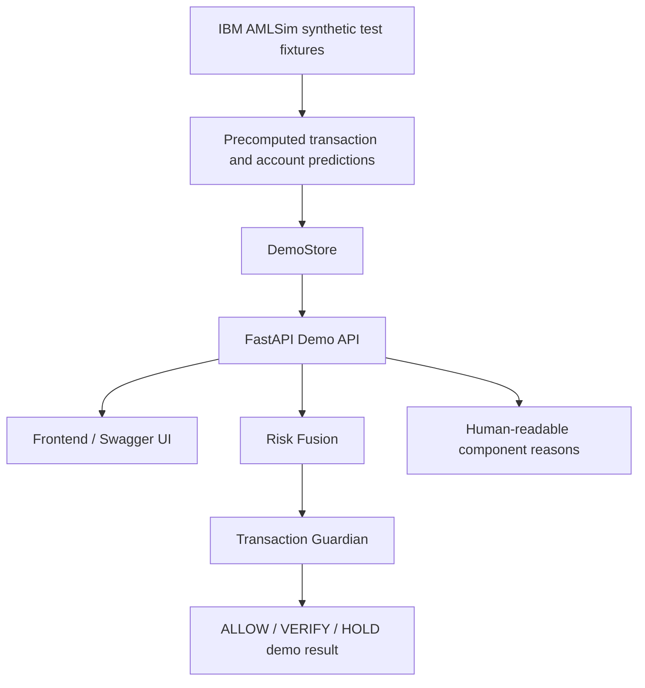
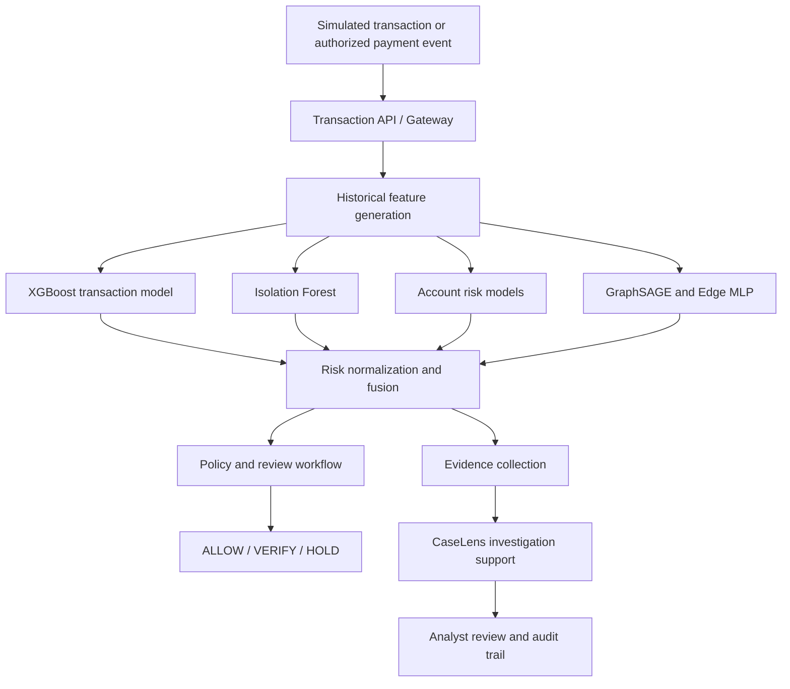

# FinSphere — FraudShield

**AI-assisted transaction fraud detection and financial network risk analysis**

FraudShield is a prototype for identifying suspicious transaction behaviour and account relationships using machine learning, graph-based models, and anomaly detection. It is developed under the **FinSphere** domain for the **FraudShield** challenge: real-time fraud and anomaly detection with an emphasis on detection precision and fewer false positives.

> **Prototype status:** The current package contains trained baseline model artifacts, feature-engineering code, a FastAPI demo API, and precomputed AMLSim test fixtures. The API currently serves precomputed demo results; it does not run the five models against each incoming transaction or connect to a bank/payment gateway.

## Objectives

- Score transaction-level and account-level risk using complementary models.
- Use historical account relationships to represent graph context.
- Identify unusual transaction patterns without requiring fraud labels for the anomaly model.
- Combine model signals into a relative risk ranking.
- Demonstrate a policy-based `ALLOW`, `VERIFY`, or `HOLD` outcome for a simulated transaction.
- Provide a foundation for graph investigation, explainable alerts, and analyst review.

## Current Prototype

### Implemented

- Five trained baseline model artifacts and Python model wrappers.
- Transaction, account-context, and anomaly feature-engineering modules.
- A fixed weighted Risk Fusion baseline.
- A deterministic Transaction Guardian demo policy.
- A FastAPI service backed by precomputed test fixtures.
- Transaction and account demo data, model metrics, and feature-importance exports.
- Basic policy tests and a package verification script.

### Planned

- Live transaction feature generation and model inference through an API.
- FlowTrace: time-aware account-network exploration and multi-hop fund-flow analysis.
- PrecisionGate: validation-based threshold selection and precision/recall-aware decisions.
- CaseLens: evidence-grounded AI investigation summaries and reason codes.
- Interactive graph explorer, analyst review workflow, and persistent audit records.
- Integration with an authorized payment/banking test environment.

Planned items are not part of the current working API unless explicitly implemented in a later version.

## Architecture

### Current prototype data flow



The model artifacts and inference wrappers are included in the package. The current API does not instantiate and execute those models for each request; it reads precomputed results from `demo_data/`.

### Intended future flow



The future flow is a development target, not a claim of an existing production integration.

## Model Catalog

| Module | Purpose | Current status |
|---|---|---|
| XGBoost Transaction Fraud | Transaction behavioural risk score using amount, time, and sender/receiver/pair history | Trained baseline V6 |
| Extra Trees Account Risk | Account-level risk from historical transaction context | Trained baseline V5 |
| GraphSAGE Node Classifier | Account risk and 32-dimensional node embeddings using account features and graph neighbours | Trained baseline V5 |
| GraphSAGE Embedding + Edge MLP | Risk score for a sender–receiver relationship/transaction using node embeddings and edge/time features | Trained baseline V5 |
| Isolation Forest | Unsupervised anomaly score for unusual transaction patterns | Trained prototype baseline |
| Risk Fusion | Combines four percentile-ranked component scores | Fixed weighted rule; not a trained meta-model |
| Transaction Guardian | Maps fused score to a demo action | Deterministic prototype policy |

### Risk Fusion

The current fusion score is a weighted combination of percentile-ranked component scores:

\[
R = 0.35X + 0.25E + 0.25A + 0.15N
\]

Where:

- `X` = XGBoost transaction rank score
- `E` = GraphSAGE + Edge MLP rank score
- `A` = account risk rank score
- `N` = Isolation Forest anomaly rank score

These rank-normalized values are combined for prototype comparison. **The fusion score is not a calibrated probability of fraud.**

### Transaction Guardian demo thresholds

| Fused score | Demo decision | Meaning in the prototype |
|---|---|---|
| `< 0.65` | `ALLOW` | No additional step in the demo policy |
| `0.65 to < 0.85` | `VERIFY` | Additional verification / review in the demo |
| `>= 0.85` | `HOLD` | Manual review required in the demo |

All decisions are labelled `SIMULATION_ONLY`. They do not authorize, reject, or hold real payments.

## Dataset and Evaluation

The current evaluation uses **IBM AMLSim 1K multi-seed synthetic data with SAR/typology proxy labels**. Test seeds `73` and `97` are held out from model development in the packaged experiment.

| Evaluation set | Rows | Positive proxy labels |
|---|---:|---:|
| Transaction test set | 170,004 | 88 |
| Account test set | 2,892 | 151 |

### Reference test metrics

| Model | Average Precision (AP) | ROC-AUC | Evaluation rows |
|---|---:|---:|---:|
| XGBoost Transaction Fraud | 47.32% | 93.67% | 170,004 transactions |
| Extra Trees Account Risk | 19.74% | 62.29% | 2,892 accounts |
| GraphSAGE Node Classifier | 18.88% | 63.80% | 2,892 accounts |
| GraphSAGE + Edge MLP | 1.23% | 78.20% | 170,004 transactions |
| Isolation Forest | Unsupervised; no supervised fraud metric claimed | — | 60,000 fit rows |

Metrics are from the packaged synthetic evaluation and should be interpreted with the very low positive-label prevalence in mind. AP is especially relevant for this imbalanced task. The edge model's ROC-AUC does not imply high precision at a selected operating threshold; its packaged test precision is low. The models are baselines and require further validation and improvement.

**Data limitation:** AMLSim SAR/typology labels are synthetic proxies. They are not verified real-world fraud or money-mule ground truth and do not establish performance on real banks, mobile financial services, or payment networks.

## Demo Results

The precomputed transaction fixtures contain the following policy outcomes:

| Demo decision | Transactions | Share |
|---|---:|---:|
| `ALLOW` | 127,176 | 74.81% |
| `VERIFY` | 36,088 | 21.23% |
| `HOLD` | 6,740 | 3.96% |
| **Total** | **170,004** | **100%** |

These are outputs of the prototype's current rank-fusion formula and demo thresholds. They are **not counts of confirmed fraud cases**.

## Technology Stack

- **Language:** Python
- **API:** FastAPI, Uvicorn
- **Data processing:** Pandas, NumPy
- **Machine learning:** XGBoost, scikit-learn, Extra Trees, Isolation Forest
- **Graph learning:** PyTorch, GraphSAGE, Edge MLP
- **Model/artifact handling:** Joblib, JSON
- **Demo data:** CSV and JSON fixtures

## Project Structure

```text
.
├── backend/
│   └── app/
│       ├── feature_engineering/
│       │   ├── transaction_features.py
│       │   ├── account_features.py
│       │   └── anomaly_features.py
│       ├── models/
│       │   ├── xgboost_transaction.py
│       │   ├── account_extra_trees.py
│       │   ├── mean_graphsage.py
│       │   ├── graphsage_node.py
│       │   ├── edge_mlp.py
│       │   ├── graphsage_edge.py
│       │   └── isolation_forest.py
│       ├── services/
│       │   ├── demo_store.py
│       │   ├── risk_fusion.py
│       │   ├── transaction_guardian.py
│       │   └── explainability.py
│       └── main.py
├── artifacts/
│   ├── model_registry.json
│   └── trained model and preprocessing artifacts
├── demo_data/
│   ├── demo_transactions_all_test.csv
│   ├── demo_transactions_top150.csv
│   ├── demo_account_risks.csv
│   ├── dashboard_overview.json
│   └── evaluation metrics and feature importance
├── docs/
│   ├── MODEL_CATALOG.md
│   └── FRONTEND_HANDOFF.md
├── scripts/
│   ├── prepare_frontend_contract.py
│   └── verify_package.py
├── tests/
│   └── test_policy.py
├── requirements.txt
└── README.md
```

## Run Locally

### Requirements

- Python 3.10 or later
- pip

### Install dependencies

```bash
python -m venv .venv
```

Activate the environment:

```bash
# Linux / macOS
source .venv/bin/activate

# Windows PowerShell
.venv\Scripts\Activate.ps1
```

Install packages:

```bash
pip install -r requirements.txt
```

### Start the API

Run from the repository root:

```bash
uvicorn backend.app.main:app --reload
```

Available local endpoints:

- API base: `http://localhost:8000`
- Swagger UI: `http://localhost:8000/docs`
- Health check: `http://localhost:8000/api/health`

## API Endpoints

| Method | Endpoint | Description |
|---|---|---|
| `GET` | `/api/health` | API and demo data status |
| `GET` | `/api/overview` | Dashboard summary and module statuses |
| `GET` | `/api/models` | Model registry and statuses |
| `GET` | `/api/transactions` | Search/filter precomputed demo transactions |
| `GET` | `/api/transactions/{transaction_id}` | One transaction with component reasons and demo decision |
| `GET` | `/api/accounts/{account_id}` | Account risk details; evaluation-only SAR label is omitted |
| `POST` | `/api/guardian/evaluate` | Apply the current weighted fusion and demo decision to supplied rank scores |

Example request:

```bash
curl -X POST "http://localhost:8000/api/guardian/evaluate" \
  -H "Content-Type: application/json" \
  -d '{
    "xgb_rank_risk": 0.80,
    "edge_rank_risk": 0.60,
    "account_rank_risk": 0.70,
    "anomaly_rank_risk": 0.90
  }'
```

`/api/guardian/evaluate` expects normalized rank inputs between `0` and `1`. It does not execute the underlying ML models.

## Validation

Run the package integrity check from the repository root:

```bash
python scripts/verify_package.py
```

The included test file contains basic checks for the Guardian decision bands and Risk Fusion weights. To run it, install `pytest` separately and execute:

```bash
python -m pytest -q
```

## Limitations and Responsible Use

- This is an offline demonstration prototype, not a production fraud-prevention system.
- The API serves precomputed synthetic test results; it does not score live bank traffic.
- There is no real bank, mobile financial service, payment gateway, or Open Banking integration.
- Risk Fusion uses fixed weights and percentile ranks; its output is not a calibrated fraud probability.
- `ALLOW`, `VERIFY`, and `HOLD` are demonstration outcomes, not approved financial-institution policies.
- Synthetic SAR/typology proxy labels are for experimentation and are not confirmed criminal or fraud labels.
- The current reason builder ranks component scores; it is not SHAP-based explainability or an LLM investigation agent.
- The current API has no authentication or role-based access control and uses permissive CORS settings. Do not expose it publicly or use it with sensitive financial data.
- Do not use the prototype to authorize, reject, freeze, or hold real transactions.

## Development Roadmap

1. Integrate the trained model wrappers into a live inference service.
2. Implement rolling historical features and controlled transaction replay.
3. Build FlowTrace for time-aware graph exploration and multi-hop fund-flow analysis.
4. Evaluate and calibrate risk signals; develop PrecisionGate using held-out validation data.
5. Add CaseLens for evidence-grounded investigation summaries and reason codes.
6. Build analyst review, audit logging, and a clearly separated customer-facing demo interface.
7. Validate the system on suitable, authorized datasets before making real-world performance claims.

## Documentation

- [`docs/MODEL_CATALOG.md`](docs/MODEL_CATALOG.md) — model purposes, inputs, outputs, statuses, and reference metrics.
- [`docs/FRONTEND_HANDOFF.md`](docs/FRONTEND_HANDOFF.md) — prototype pages, UI requirements, API contract, and demo-data fields.

---

**FinSphere | FraudShield**  
Prototype for the FraudShield hackathon challenge.
