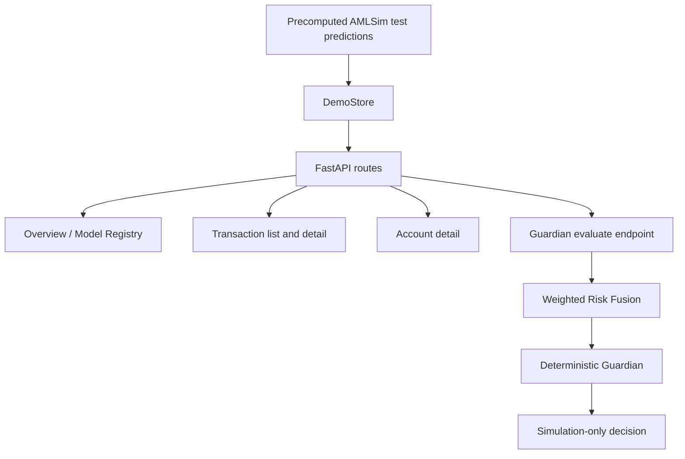

# FinSphere — FraudShield | Technical Whitepaper

## Abstract

FraudShield is a prototype for transaction and account risk analysis using complementary machine-learning signals. The packaged implementation includes trained baseline artifacts, feature-engineering modules, precomputed synthetic evaluation fixtures, and a FastAPI demo service. This paper documents the current implementation and separates it from proposed future architecture.

## 1. Challenge and technical objective

The challenge is real-time fraud and anomaly detection across transactions, with emphasis on detection precision and low false positives. FraudShield investigates whether transaction-level patterns, account context, graph relationships, and unsupervised anomaly signals can provide complementary evidence for risk ranking.

## 2. Current implementation scope

The package contains:

- Five trained baseline model artifacts and Python wrappers.
- Transaction, account-context, and anomaly feature-engineering modules.
- A fixed weighted Risk Fusion function.
- A deterministic Transaction Guardian policy.
- A FastAPI demo service backed by precomputed CSV/JSON fixtures.
- Model metrics, feature-importance exports, a model registry, and basic policy tests.

**Important:** The API does not load and execute all five models for every incoming request. It reads precomputed predictions through `DemoStore`. There is no live bank/payment gateway integration or streaming inference pipeline in this package.

## 3. Dataset

**Dataset:** IBM AMLSim 1K multi-seed synthetic data with SAR/typology proxy labels.  
**Held-out simulation seeds:** 73 and 97.  
**Transaction test set:** 170,004 transactions, 88 positive proxy labels.  
**Account test set:** 2,892 accounts, 151 positive proxy labels.

The positive transaction-label prevalence is approximately 0.052%. This severe class imbalance makes accuracy alone an unsuitable headline metric. Average Precision and precision/recall at the intended operating threshold should be examined.

The labels represent synthetic SAR/typology proxies. They are not verified real-world fraud, money-mule, or criminal-activity ground truth. Held-out seeds test variation across stochastic simulations within the configured AMLSim setup; they do not establish generalization to real financial institutions.

## 4. Model catalog

| Module | Method | Inputs / context | Output | Package status |
|---|---|---|---|---|
| M1 | XGBoost Transaction Fraud | Amount, time, sender/receiver/pair history | Transaction risk score | Trained baseline V6 |
| M2 | Extra Trees Account Risk | Historical account-context features | Account risk score | Trained baseline V5 |
| M3 | GraphSAGE Node | Account features and historical graph neighbours | Node risk and 32-dimensional embedding | Trained baseline V5 |
| M4 | GraphSAGE Embedding + Edge MLP | Source/destination embeddings and edge/time features | Graph edge risk | Trained baseline V5 |
| M5 | Isolation Forest | Amount, prior counts/averages, time signals | Anomaly score | Trained prototype baseline |

### 4.1 XGBoost Transaction Fraud

Uses transaction attributes and historical behaviour patterns for the sender, receiver, and account pair. It is the strongest current transaction-level ranking baseline in the packaged reference metrics.

### 4.2 Extra Trees Account Risk

Estimates account-level suspicious typology risk from historical account-context features. Its output is an account risk score, not a transaction fraud probability.

### 4.3 GraphSAGE Node Classifier

Uses account features and historical graph-neighbour context to produce account-level risk and a 32-dimensional node embedding.

### 4.4 GraphSAGE Embedding + Edge MLP

Uses source and destination account embeddings together with edge/time features to score a relationship or transaction edge. Its current Average Precision is low; the score should not be treated as reliable standalone evidence for an automatic hold decision.

### 4.5 Isolation Forest

Produces an unsupervised anomaly score from transaction feature patterns. Because it is unsupervised, the package does not claim a supervised fraud AP or ROC-AUC for this model.

## 5. Risk Fusion

The current fusion function expects percentile-normalized component ranks in the 0–1 range:

\[
R = 0.35X + 0.25E + 0.25A + 0.15N
\]

Where:

- `X`: XGBoost transaction rank score.
- `E`: GraphSAGE + Edge MLP rank score.
- `A`: account risk rank score.
- `N`: Isolation Forest anomaly rank score.

This is a fixed weighted rule, not a trained Logistic Regression model or learned meta-classifier. Its output is a relative rank-based demo score, not a calibrated probability of fraud. Component calibration and leakage-safe fusion training are future research/development tasks.

## 6. Transaction Guardian

The current deterministic policy uses the fused score:

| Score | Decision | Demo meaning |
|---|---|---|
| `< 0.65` | `ALLOW` | No additional step in demo policy |
| `0.65` to `< 0.85` | `VERIFY` | Step-up verification required in demo |
| `>= 0.85` | `HOLD` | Manual review required in demo |

Every outcome is tagged `SIMULATION_ONLY`. These thresholds are demonstration bands, not bank policy and not a live authorization or payment-blocking mechanism.

## 7. Current software architecture



### 7.1 Backend modules

- `backend/app/main.py`: FastAPI application and routes.
- `backend/app/services/demo_store.py`: loads precomputed demo fixtures.
- `backend/app/services/risk_fusion.py`: fixed weighted fusion calculation.
- `backend/app/services/transaction_guardian.py`: deterministic decision thresholds.
- `backend/app/services/explainability.py`: builds component-level reasons.
- `backend/app/feature_engineering/`: transaction, account, and anomaly feature preparation.
- `backend/app/models/`: model wrappers.
- `artifacts/`: trained model and preprocessing artifacts.
- `demo_data/`: precomputed test results and evaluation exports.

### 7.2 API endpoints

Base URL: `http://localhost:8000`

| Method | Endpoint | Behaviour |
|---|---|---|
| GET | `/api/health` | Returns prototype status and precomputed data source |
| GET | `/api/overview` | Returns dashboard summary |
| GET | `/api/models` | Returns model registry/status |
| GET | `/api/transactions` | Returns precomputed rows; supports `decision`, `search`, `limit` |
| GET | `/api/transactions/{transaction_id}` | Returns transaction detail, component reasons, and demo decision |
| GET | `/api/accounts/{account_id}` | Returns account risk detail; removes evaluation-only SAR membership label |
| POST | `/api/guardian/evaluate` | Accepts four normalized rank scores and returns fusion/policy output |

Example request:

```json
{
  "xgb_rank_risk": 0.8,
  "edge_rank_risk": 0.6,
  "account_rank_risk": 0.7,
  "anomaly_rank_risk": 0.9
}
```

## 8. Reference evaluation results

| Model | Average Precision | ROC-AUC | Test rows | Positive proxy labels |
|---|---:|---:|---:|---:|
| XGBoost Transaction Fraud | 47.32% | 93.67% | 170,004 transactions | 88 |
| Extra Trees Account Risk | 19.74% | 62.29% | 2,892 accounts | 151 |
| GraphSAGE Node Classifier | 18.88% | 63.80% | 2,892 accounts | 151 |
| GraphSAGE Embedding + Edge MLP | 1.23% | 78.20% | 170,004 transactions | 88 |
| Isolation Forest | Unsupervised; no supervised metric claimed | — | 60,000 fit rows | — |

### 8.1 Interpretation

- **XGBoost:** Best current transaction-level AP and ROC-AUC among the packaged supervised baselines. Threshold-specific precision still requires attention.
- **Extra Trees:** Account-level baseline; requires further validation and improvement.
- **GraphSAGE Node:** Does not outperform Extra Trees on the supplied account-level reference metrics.
- **GraphSAGE + Edge MLP:** ROC-AUC is higher than random ranking, but AP is only 1.23%; this indicates weak positive-class retrieval under the highly imbalanced test distribution.
- **Isolation Forest:** Needs ranking-oriented anomaly evaluation, such as Precision@K and review of known synthetic proxy cases; no supervised fraud metric is claimed.

Packaged operating-point results for XGBoost show low precision (4.85% for seed 73 and 3.33% for seed 97) despite recall of 68.75% and 65.00%, respectively. The edge model's documented operating point has 1.53% precision and 35.23% recall. These results reinforce the need for threshold selection and false-positive analysis before any operational use.

## 9. Precomputed demo decision distribution

| Decision | Transactions | Share |
|---|---:|---:|
| `ALLOW` | 127,176 | 74.81% |
| `VERIFY` | 36,088 | 21.23% |
| `HOLD` | 6,740 | 3.96% |
| **Total** | **170,004** | **100%** |

These are demo policy outputs over precomputed fixtures. They are not counts of confirmed fraudulent transactions.

## 10. Frontend and monitoring specification

The frontend handoff describes seven desktop-first pages:

1. **Overview:** KPI cards, risk distribution, recent high-risk rows, and model status.
2. **Transaction Monitor:** Searchable/filterable precomputed transaction table.
3. **Transaction Detail:** Transaction context, four risk-signal cards, fused score, reasons, and simulated decision.
4. **Account Intelligence:** Account risk details and available account-level scores.
5. **Graph Explorer:** Intended graph visualization; graph data integration is a placeholder in the supplied package.
6. **Model Center:** Seven module cards, status, purpose, metrics, and limitations.
7. **Decision & Audit:** Simulated decisions; audit workflow is a placeholder.

UI requirements: show `SIMULATION ONLY`; label values as `Risk score` or `Relative risk`, never `fraud probability`; display the synthetic dataset name; retain evaluation split and positive sample count with metrics; mark placeholders explicitly.

## 11. Planned development

### FlowTrace

Develop a time-aware graph investigation layer to explore account relationships, incoming/outgoing transaction patterns, suspicious clusters, and multi-hop fund movement. Graph Explorer and data integration are not complete in the current package.

### PrecisionGate

Build a validation-based operating-threshold workflow. Evaluate precision, recall, false-positive rate, alert volume, and Precision@K. Select thresholds using validation data and report held-out test performance separately. The objective is to reduce unnecessary alerts without hiding the trade-off with missed positives.

### CaseLens

Develop an evidence-grounded investigation assistant that summarizes model outputs, relevant transaction features, and graph evidence into analyst-readable reason codes. The assistant must cite supplied evidence, distinguish facts from hypotheses, avoid inventing evidence, and leave final case decisions to a human analyst.

### Live scoring

Create a transaction scoring service that loads the trained artifacts, validates inputs, computes current/historical features, obtains all required model outputs, normalizes/calibrates compatible signals, and records the resulting decision context. Graph models require maintained historical graph state and appropriate embeddings/features.

### Governance and operations

Add role-based access, data minimization, encryption, audit logs, model/version tracking, drift monitoring, analyst feedback, and controlled deployment/testing before any real financial integration.

## 12. Risks and limitations

- Synthetic SAR/typology proxy labels do not prove real-world fraud detection.
- Current API serves precomputed outputs rather than live model inference.
- Fixed weighted fusion is not a trained or calibrated meta-model.
- Rank scores are not calibrated fraud probabilities.
- Graph Explorer and audit workflows are not fully backed by graph/audit services in the current package.
- The current policy is for demonstration only and must not be used to authorize or block real payments.
- Production use would require independent data validation, security/privacy review, compliance assessment, human oversight, and monitored integration testing.

## 13. Conclusion

The current FraudShield package establishes a multi-model synthetic-data prototype and a transparent demonstration API. Its strongest immediate next steps are improving threshold-specific precision, integrating model inference into a transaction scoring pipeline, strengthening graph-based relationship analysis, and delivering evidence-grounded analyst explanations. Any claim of real-time or production fraud prevention must wait until those capabilities are implemented and independently validated.
